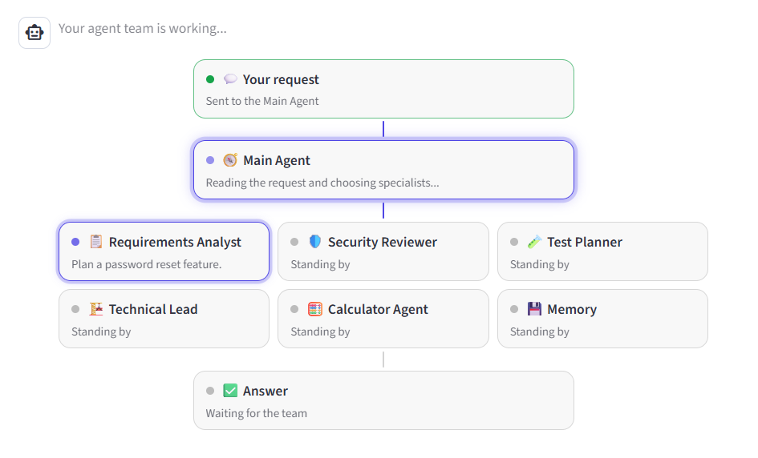
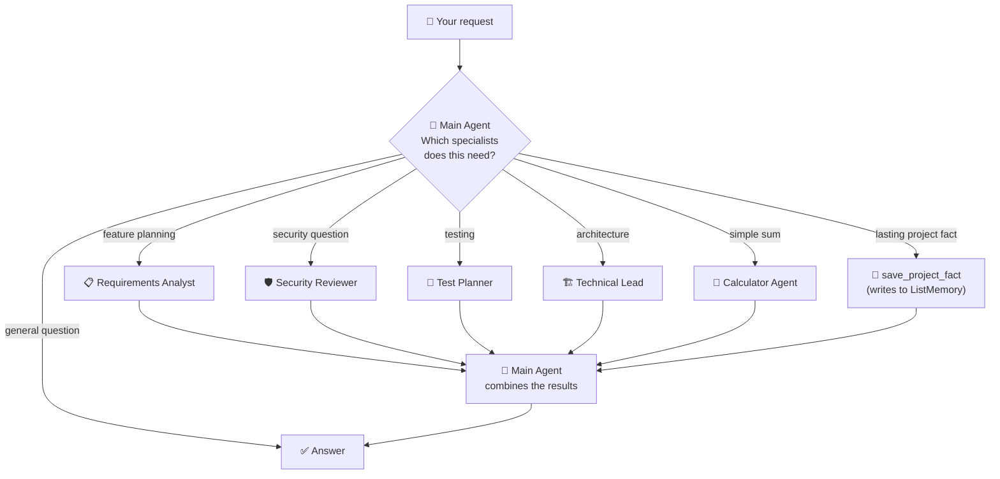
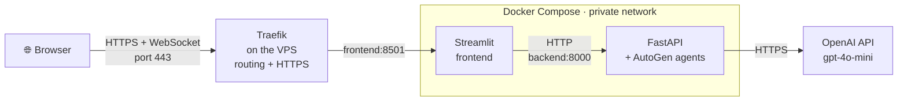
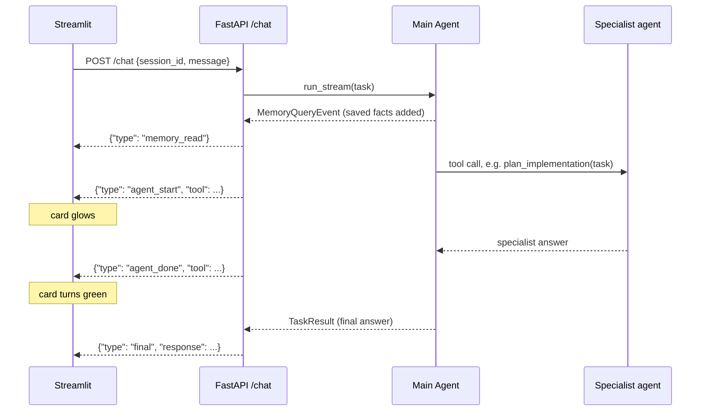

# 🧭 AgentDesk

**A small, complete multi-agent application built with Microsoft AutoGen, showing how agents decide, delegate and remember.**


You type a request. A **Main Agent** reads it, decides which specialist agents it actually needs, hands each one a task, and combines their answers. The UI lights up each agent while it works, so you can watch the decision happen.



The agents play the roles of a small software team, but the domain is just the example. The point of the project is the machinery underneath: **agent routing, tools, conversation history, memory, live event streaming, and a containerised frontend and backend behind a reverse proxy.**

## 🎬 Demo

https://github.com/user-attachments/assets/23b57ce7-2936-4019-8353-6978d72c4ff4

In this video (with narration, turn the sound on):

1. *What is 25 + 17?* goes to the Calculator Agent only. Every other specialist is marked "Not needed".
2. *Plan a password reset feature* brings in four specialists at once. Each card glows while it works and turns green when done.
3. *My app uses Laravel and MySQL* is saved to `ListMemory` by the Main Agent and appears in the sidebar.
4. After **New chat** the history is empty, yet *What framework does my app use?* is still answered correctly from the saved fact.
5. The **About** panel shows the agent team.

---

## What this project demonstrates

| Concept | Where you can see it |
|---|---|
| **Agents as tools.** Each specialist is an AutoGen `AssistantAgent` wrapped in a function the Main Agent can call | [`backend/agents.py`](backend/agents.py) |
| **Routing by the model itself.** The Main Agent chooses tools; there is no hand-written `if/else` routing | Main Agent system message in [`backend/agents.py`](backend/agents.py) |
| **A real tool.** The Calculator Agent adds numbers with Python, not with the language model | `add_numbers` in [`backend/agents.py`](backend/agents.py) |
| **Conversation history vs `ListMemory`.** Two different kinds of memory, with commands to reset each one | Memory section below, `/new-chat` and `/new-session` in [`backend/main.py`](backend/main.py) |
| **The agent decides what to remember.** A `save_project_fact` tool writes to `ListMemory` | [`backend/agents.py`](backend/agents.py) |
| **Live streaming with `run_stream()`.** AutoGen events are streamed to the browser as they happen | `/chat` in [`backend/main.py`](backend/main.py) |
| **One conversation per user.** Session IDs give every browser tab its own agents and memory | [`backend/main.py`](backend/main.py) |
| **Basic protection for a public demo.** Input/output limits, idle cleanup and an optional per-IP chat limit | [`.env.example`](.env.example), Configuration section below |
| **Frontend and backend as separate services.** They only talk over HTTP | [`frontend/app.py`](frontend/app.py) ↔ [`backend/main.py`](backend/main.py) |
| **Docker Compose + Traefik.** Traefik on the VPS routes the domain and handles HTTPS; the backend stays on a private network | [`docker-compose.yml`](docker-compose.yml) |

---

## 🤖 How the agents work together



Every agent is an AutoGen `AssistantAgent` using OpenAI `gpt-4o-mini`. The specialists are given to the Main Agent as **tools**. When the model decides to call `review_security`, that function runs the Security Reviewer agent and returns its answer to the Main Agent.

| Agent | Role | Called when |
|---|---|---|
| 🧭 **Main Agent** | Understands the request, chooses specialists, combines their answers | Always |
| 📋 **Requirements Analyst** | Functional requirements, assumptions, acceptance criteria | Planning a feature |
| 🛡️ **Security Reviewer** | Security risks and safeguards | Anything with a security angle |
| 🧪 **Test Planner** | Test cases for normal use, edge cases and failures | Testing questions, feature plans |
| 🏗️ **Technical Lead** | Architecture and implementation approach | Design and "how should we build it" questions |
| 🧮 **Calculator Agent** | Adds numbers using a real Python function | "What is 25 + 17?" |
| 💾 **Memory** (a tool, not an agent) | Saves lasting facts about your project | "My app uses Laravel and MySQL" |

**Examples of routing**

| You ask | What happens |
|---|---|
| *What is 25 + 17?* | Only the Calculator Agent runs |
| *What are the security risks of file uploads?* | Only the Security Reviewer runs |
| *Plan a password reset feature* | Several specialists run, often in parallel |
| *What did the Technical Lead recommend?* | No specialist; the Main Agent answers from conversation history |
| *What is the capital of France?* | No specialist; the Main Agent answers directly |

The specialists are written for software project questions. Anything else is simply answered by the Main Agent on its own.

---

## 🧠 Two kinds of memory

AutoGen agents have two separate ways of "remembering", and this project keeps them deliberately apart so you can see the difference.

| | **Conversation history** | **`ListMemory`** |
|---|---|---|
| What it is | Every message the agent has seen in this chat | A short list of facts stored outside the agent |
| Where it lives | Inside each `AssistantAgent` (its model context) | A `ListMemory` object attached to the Main Agent with `memory=[...]` |
| Who writes to it | AutoGen, automatically | The Main Agent, by deciding to call `save_project_fact` |
| How it is used | Sent to the model on every turn | Every stored item is added to the Main Agent's context before each run |
| Cleared by | **New chat** | **New session** |

**Why not save the whole conversation into `ListMemory`?** It would duplicate what the history already holds. `ListMemory` also has no search: it adds *every* item on *every* turn, so a full transcript would grow quickly and cost more tokens. A short list of durable facts is the kind of thing it suits. A vector memory with real retrieval would be the next step for storing much more.

**Try this to see each one on its own:**

1. Type *My app uses Laravel 10 and MySQL*. The Main Agent saves it, and it appears under **Memory** in the sidebar.
2. Click **New chat**. The agents are recreated with empty histories.
3. Ask *What framework does my app use?* The answer says Laravel, with a note that a saved fact was used. That came from `ListMemory`, because the history is empty.
4. Click **New session** and ask again. Now nothing is remembered.

---

## 🏗️ Architecture



- **Traefik** runs on the VPS (outside this project) and owns ports 80/443. It reads the `labels` on the `frontend` service, routes `autogendemo.labspace.tech` to Streamlit, gets a free Let's Encrypt certificate, and passes WebSockets and the visitor's IP through.
- **Streamlit** is a Python server, so it calls the backend from *inside* Docker. The browser never talks to the backend directly, which is why the backend needs no public route at all.
- **FastAPI** owns the agents, the sessions and the limits. The OpenAI key is given only to this container.
- Containers find each other by **service name** (`frontend`, `backend`) on the network Compose creates.

### What happens during one request



The backend reads AutoGen events from `run_stream()` (`ToolCallRequestEvent`, `ToolCallExecutionEvent`, `MemoryQueryEvent`, `TaskResult`) and sends each one to the browser as a line of JSON (NDJSON). The lights in the UI are driven by real agent activity, not by a timer.

---

## 🚀 Run it with Docker (recommended)

You need [Docker Desktop](https://www.docker.com/products/docker-desktop/) and an OpenAI API key.

```bash
git clone <this-repo-url>
cd autogen-multiagent-docker-agentdesk

# Create your own .env from the template, then add your OpenAI key
cp .env.example .env        # Windows PowerShell: Copy-Item .env.example .env

docker compose up --build
```

Open **http://localhost:8502**.

| Command | What it does |
|---|---|
| `docker compose up --build -d` | Build and start everything in the background |
| `docker compose logs -f backend` | Watch the agents work (`[Technical Lead] Working...`) |
| `docker compose ps` | See running containers and published ports |
| `docker compose down` | Stop and remove the containers |

After changing Python code, run `docker compose up --build -d`. After changing `.env`, run `docker compose up -d`. A plain `restart` does not reload `.env`.

---

## 💻 Run it locally without Docker

Useful while developing. You need two terminals, each with the virtual environment active.

```bash
python -m venv .venv
.venv\Scripts\Activate.ps1          # macOS/Linux: source .venv/bin/activate
pip install -r backend/requirements.txt -r frontend/requirements.txt
```

```bash
# Terminal 1: backend (from the project root)
uvicorn backend.main:app --reload

# Terminal 2: frontend (from inside the frontend folder, so .streamlit/config.toml is found)
cd frontend
streamlit run app.py
```

Open **http://localhost:8501**. The FastAPI docs are at **http://127.0.0.1:8000/docs**.

### Console version

The project started as a terminal app, and it still works. It uses the same agents:

```bash
python app.py
```

Commands: `memory`, `new chat`, `new session`, `exit`.

---

## ⚙️ Configuration

All settings live in `.env` (see [`.env.example`](.env.example)). The same code runs locally and in a public demo; only these values change.

| Variable | Default | Purpose |
|---|---|---|
| `OPENAI_API_KEY` | (required) | Used by the backend only |
| `MAX_INPUT_CHARS` | `1000` | Longer messages are rejected with a friendly message |
| `MAX_OUTPUT_TOKENS` | `1000` | Caps every model reply, for the Main Agent and each specialist |
| `SESSION_IDLE_MINUTES` | `30` | Sessions unused for this long are deleted |
| `DEMO_CHAT_LIMIT` | `0` | Chats allowed per visitor IP. `0` means unlimited, for local use |

## 🔌 API

| Method | Endpoint | Purpose |
|---|---|---|
| `POST` | `/chat` | Run the Main Agent. Streams NDJSON events, ending with the final answer |
| `POST` | `/new-chat` | New agents (empty history), same `ListMemory` |
| `POST` | `/new-session` | Delete the session: agents and `ListMemory` |
| `GET` | `/memory/{session_id}` | List the stored facts |

---

## 📁 Project structure

```
├── backend/
│   ├── agents.py          # All agents, their tools, and the Main Agent
│   ├── main.py            # FastAPI app: sessions, limits, streaming /chat
│   ├── Dockerfile
│   └── requirements.txt
├── frontend/
│   ├── app.py             # Streamlit UI and the live agent flow
│   ├── .streamlit/config.toml
│   ├── Dockerfile
│   └── requirements.txt
├── app.py                 # Console version using the same agents
├── docker-compose.yml     # frontend (Traefik labels) + backend (private)
└── .env.example           # Settings template. Copy it to .env
```

## ⚠️ Known limitations

These are deliberate simplifications for a demo:

- **State is kept in memory.** Sessions, `ListMemory` and chat counts are lost when the backend restarts, and the app runs as a single backend instance.
- **The IP limit is simple.** It is good enough to stop casual overuse of a public demo, but it is not a security control.
- **No login.** Every browser tab is a new anonymous session.

## 🗺️ Roadmap

- [x] Console multi-agent app with routing, tools and memory
- [x] FastAPI backend with sessions and limits
- [x] Streamlit frontend with live agent flow
- [x] Docker Compose with a private backend
- [ ] Deploy to a VPS behind Traefik with a domain and HTTPS

## 🧰 Tech stack

Microsoft AutoGen AgentChat 0.7 · OpenAI gpt-4o-mini · FastAPI · Uvicorn · Streamlit · Traefik · Docker Compose · Python 3.13
